  <picture>
    <source media="(prefers-color-scheme: dark)" srcset="https://raw.githubusercontent.com/Srinidhi-111/Srinidhi-111/main/assets/cosmic-banner.svg?v=9">
    <source media="(prefers-color-scheme: light)" srcset="https://raw.githubusercontent.com/Srinidhi-111/Srinidhi-111/main/assets/cosmic-banner-light.svg?v=9">
    
  </picture>

 

<a href="https://www.linkedin.com/in/srinidhi-rajesh-kanna-b39150339/"><strong>LinkedIn</strong></a>
&nbsp;&nbsp;·&nbsp;&nbsp;
<a href="mailto:srinidhir.cs24@bitsathy.ac.in"><strong>Email</strong></a>
&nbsp;&nbsp;·&nbsp;&nbsp;
<a href="https://github.com/Srinidhi-111"><strong>GitHub</strong></a>

## Hi, I’m Srinidhi

I am a Computer Science and Engineering student at **Bannari Amman Institute of Technology**, exploring ideas across software development, artificial intelligence, cloud technologies, cybersecurity, UI/UX, and data-driven applications.

I learn best by building. I enjoy taking an idea from problem discovery to a working product: understanding people, designing useful experiences, building the system behind them, integrating technologies, and improving it through testing and iteration.

I am particularly interested in software that combines thoughtful design, reliable engineering, real-time information, and practical problem-solving.

  <picture>
    <source media="(prefers-color-scheme: dark)" srcset="https://raw.githubusercontent.com/Srinidhi-111/Srinidhi-111/main/assets/project-stars.svg?v=5">
    <source media="(prefers-color-scheme: light)" srcset="https://raw.githubusercontent.com/Srinidhi-111/Srinidhi-111/main/assets/project-stars-light.svg?v=5">
    
  </picture>

## Featured projects

### UX Session Replay Analytics

> **Live · Patent application filed · Fifth-semester mini project**

A privacy-aware UX analytics platform that records real user sessions, replays them, and automatically flags frustration signals such as rage clicks, so developers can see exactly where people struggle.

**Tech stack:** React, TypeScript, Vite, Tailwind CSS, FastAPI, PostgreSQL (Neon), WebSockets, rrweb, Vitest, Vercel, Render

- Built a sliding-window rage-click detector with four severity levels, covered by automated tests.
- Recorded full sessions with rrweb and built a replay viewer with rage-click markers on the timeline.
- Built a live dashboard over WebSockets: metric cards, click heatmap, severity alerts, session timeline and filters.
- Deployed the full pipeline on Vercel, Render and Neon, and fixed real production issues such as idle-connection drops and a concurrent-insert race condition.
- Worked on the backend in a team of three. A patent application has been filed and a research paper is in progress.

[Live demo](https://ux-session-replay-analytics.vercel.app) · [Repository](https://github.com/Srinidhi-111/UX-Session-Replay-Analytics)

### Jawabdehi

> **7th place · HACKCACHE'26, national-level hackathon**

A citizen-powered government accountability platform. Jawabdehi means "accountability" in Hindi. A complaint against an official is kept in an append-only, hash-chained record that nobody can quietly rewrite, and it moves up a chain of authorities automatically when an office stays silent.

**Tech stack:** React, Vite, Tailwind CSS, Web Crypto (SHA-256), IndexedDB, Vercel serverless functions, Anthropic API

- Built a tamper-evident record: every event is chained with SHA-256, and a "Verify this record" check finds the exact entry that was changed after a tamper test.
- Wrote an escalation engine that works out each complaint's state from its events alone and moves it up the chain when acknowledgement or response deadlines pass.
- Kept privacy rules in one place, so each role (citizen, official, reviewer, public) sees only what it is allowed to, and confirmed with a leak test.
- Added an AI-drafted report in which every field must quote the citizen's own words, checked on the server, with a rule-based fallback when no key is set.
- Built legal-help routes that put free legal aid options first.

> **Note:** Jawabdehi is a hackathon prototype. Officials, offices, complaints and lawyers are all made up, time is simulated with demo controls, and data stays in the browser.

[Live demo](https://jawabdehi-eosin.vercel.app/) · [Repository](https://github.com/Srinidhi-111/HACKCACHE-26)

### StreetGuard

A parametric income-protection prototype for gig delivery workers affected by verified weather and city-level disruptions.

**Tech stack:** React, Tailwind CSS, FastAPI, Python, Firebase, OpenWeatherMap, WAQI, Razorpay Test Mode, scikit-learn, Vercel, Railway

- Designed and developed an end-to-end prototype for income-protection workflows for gig delivery workers.
- Built the product flow around worker onboarding, zone risk, policy coverage, disruption monitoring, claim initiation, and payout simulation.
- Designed weather- and city-disruption trigger logic for rainfall, extreme heat, air quality, platform downtime, and manual disruption events.
- Integrated or architected external data, Firebase, backend, machine-learning, and sandbox-payment components for the MVP workflow.
- Created a loss-simulation dashboard to show potential disruption-related income loss and coverage scenarios.
- Built for **Guidewire DEVTrails 2026** with Team Code4ce and reached the **Diamond tier**, roughly the top 1% of around 1,800 to 2,000 teams.

> **Note:** StreetGuard is a hackathon prototype. It does not issue regulated insurance policies or process real payouts. Test-mode and simulated integrations are used where production access is not available.

[Live demo](https://srinidhi-111.github.io/streetguard-demo/) · [Repository](https://github.com/Srinidhi-111/streetguard) · [Pitch deck](https://docs.google.com/presentation/d/1v2v14qv_H5xEEdcNhWL0Ht9p7J6llaco/edit?usp=sharing&ouid=118022404412997280067&rtpof=true&sd=true)

### Meiyaa

A Tamil-English code-mixed scam and misinformation detector for WhatsApp forwards and SMS.

**Tech stack:** Python, FastAPI, React, Vite, sentence-transformers, NLP, JSON

- Built an explainable message-risk analysis tool for Tamil script, Tanglish, and English code-mixed messages.
- Implemented a workflow that produces a risk score, flagged suspicious phrases, and a plain-language explanation.
- Designed a curated seed dataset covering job scams, fake loans, OTP phishing, health misinformation, lottery scams, and safe-control messages.
- Used privacy-conscious reconstructed examples informed by public scam and misinformation advisories rather than private user messages.
- Built for **OpenHack26**, a FOSS Community hackathon.

[Repository](https://github.com/Srinidhi-111/OpenHack26)

  <picture>
    <source media="(prefers-color-scheme: dark)" srcset="https://raw.githubusercontent.com/Srinidhi-111/Srinidhi-111/main/assets/orbit-divider.svg?v=5">
    <source media="(prefers-color-scheme: light)" srcset="https://raw.githubusercontent.com/Srinidhi-111/Srinidhi-111/main/assets/orbit-divider-light.svg?v=5">
    
  </picture>

## Technical focus

| Area | Technologies |
|---|---|
| **Languages** | Python, TypeScript, JavaScript, Java, C, SQL |
| **Frontend** | React, Vite, HTML, CSS, Tailwind CSS |
| **Backend** | FastAPI, REST APIs, WebSockets |
| **Data** | PostgreSQL, Firebase, Pandas |
| **AI and NLP** | sentence-transformers, Groq API, scikit-learn, Generative AI |
| **Cloud and deployment** | Vercel, Render, Railway, Microsoft Azure, Google Cloud Platform, Oracle Cloud Infrastructure |
| **Tools** | Git, GitHub, VS Code, Figma, Framer |

## Currently exploring

- Backend architecture and scalable API design
- Privacy-aware analytics and event-processing systems
- Artificial intelligence for practical product workflows
- Cloud deployment, observability, testing, and application security
- Data structures and algorithms
- Agentic AI, and building **Undertow**, a radar for risky packages in a project

  <picture>
    <source media="(prefers-color-scheme: dark)" srcset="https://raw.githubusercontent.com/Srinidhi-111/Srinidhi-111/main/assets/orbit-divider.svg?v=5">
    <source media="(prefers-color-scheme: light)" srcset="https://raw.githubusercontent.com/Srinidhi-111/Srinidhi-111/main/assets/orbit-divider-light.svg?v=5">
    
  </picture>

## Building in public

I use GitHub to document experiments, prototypes, hackathon projects, and evolving software systems. The repositories above reflect work I have built, explored, and continue to improve.

  <picture>
    <source media="(prefers-color-scheme: dark)" srcset="https://raw.githubusercontent.com/Srinidhi-111/Srinidhi-111/main/assets/orbit-divider.svg?v=5">
    <source media="(prefers-color-scheme: light)" srcset="https://raw.githubusercontent.com/Srinidhi-111/Srinidhi-111/main/assets/orbit-divider-light.svg?v=5">
    
  </picture>

## Connect

<a href="https://www.linkedin.com/in/srinidhi-rajesh-kanna-b39150339/">LinkedIn</a>
&nbsp;&nbsp;·&nbsp;&nbsp;
<a href="mailto:srinidhir.cs24@bitsathy.ac.in">Email</a>
&nbsp;&nbsp;·&nbsp;&nbsp;
<a href="https://github.com/Srinidhi-111">GitHub</a>

 

  <picture>
    <source media="(prefers-color-scheme: dark)" srcset="https://raw.githubusercontent.com/Srinidhi-111/Srinidhi-111/main/assets/footer-nebula.svg?v=5">
    <source media="(prefers-color-scheme: light)" srcset="https://raw.githubusercontent.com/Srinidhi-111/Srinidhi-111/main/assets/footer-nebula-light.svg?v=5">
    
  </picture>

